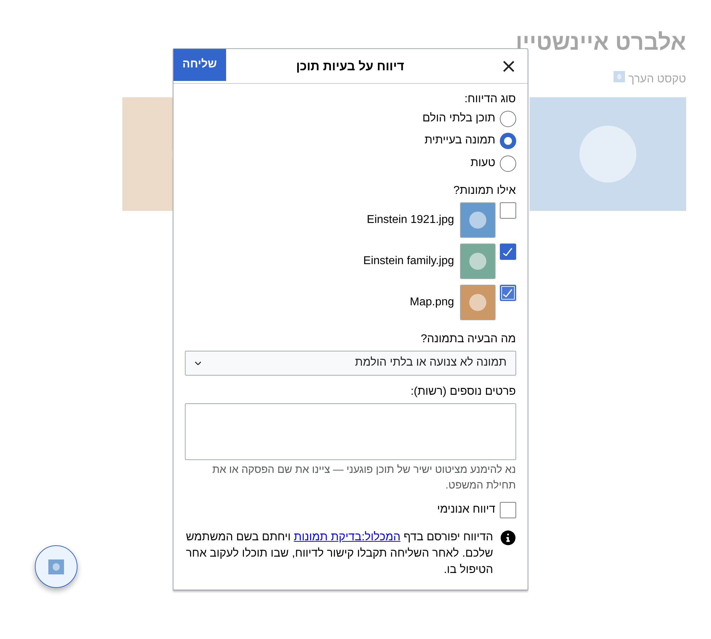
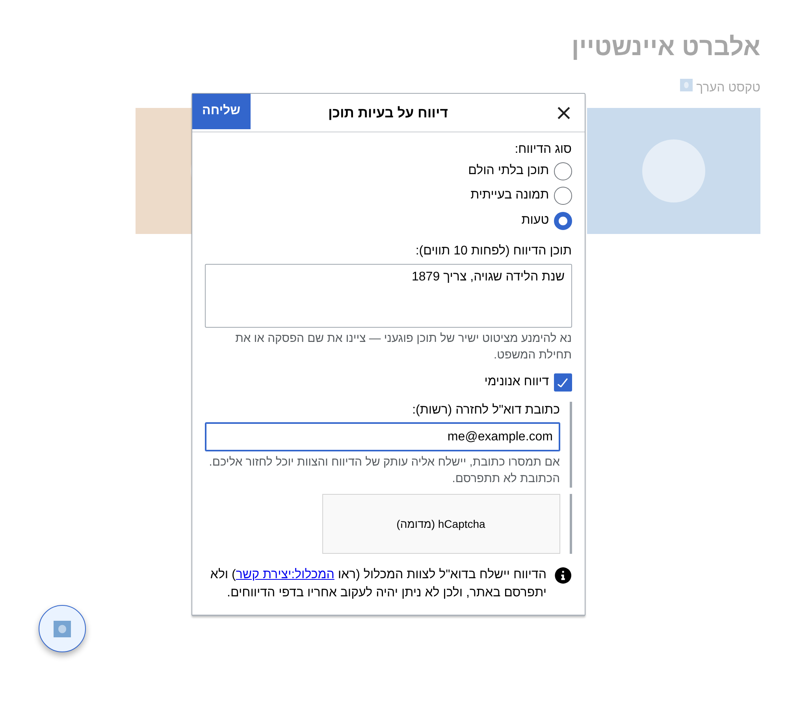
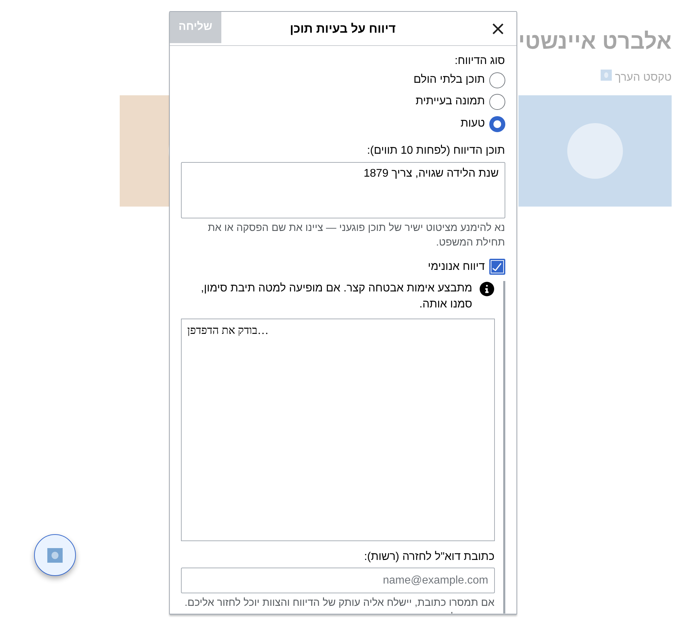
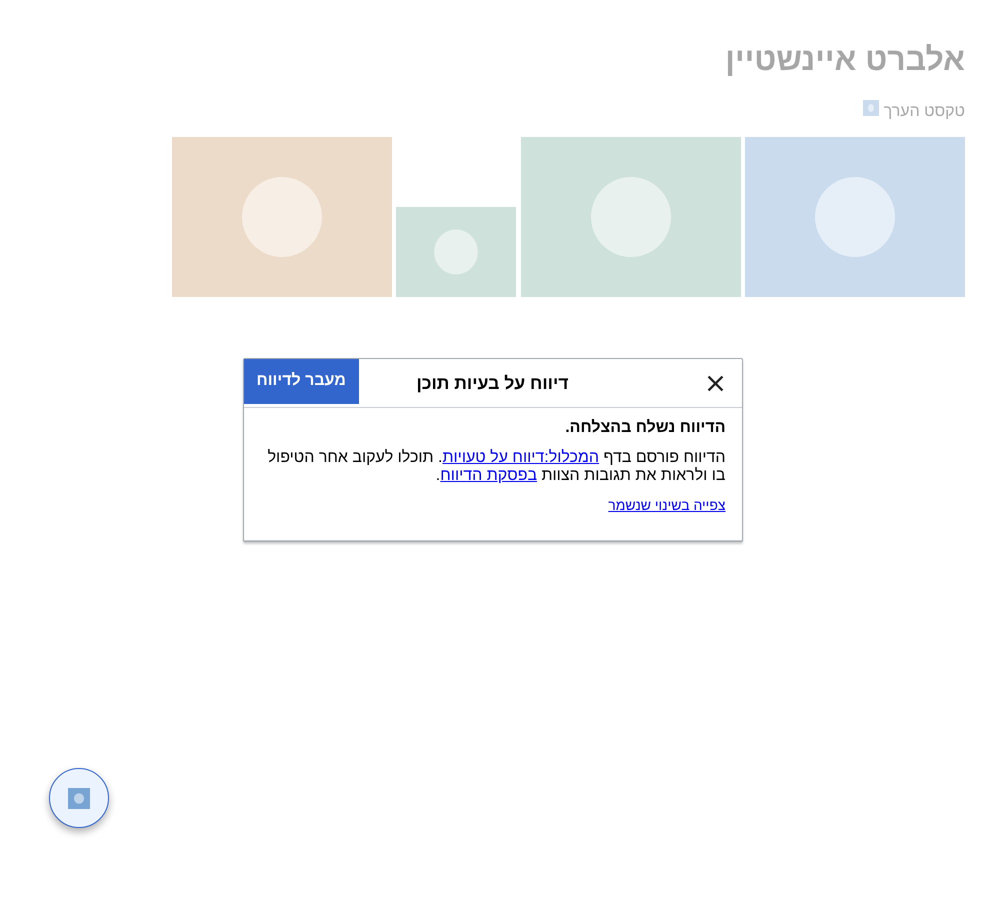

# דיווח על בעיות תוכן — גאדג'ט להמכלול

גאדג'ט שמוסיף כפתור צף בדפי ערכים ובדפי קבצים, לדיווח על:

| סוג דיווח | דף הדיווחים |
|---|---|
| תוכן בלתי הולם | `המכלול:דיווח על תוכן בלתי הולם` |
| **תמונה בעייתית** (חדש) | `המכלול:בדיקת תמונות` |
| טעות | `המכלול:דיווח על טעויות` |

## מה חדש לעומת הגרסה הקודמת

### יכולות חדשות
- **דיווח על תמונות** — החלון מציג את התמונות שבדף (בגודל 30 פיקסלים לפחות, בלי כפילויות) עם תמונה ממוזערת קטנה ושם הקובץ, ומסמנים את התמונות הבעייתיות. את הסיבה בוחרים מרשימה (לא צנועה/בלתי הולמת, לא קשורה לערך, זכויות יוצרים, אחר). כשסומנה תמונה, הטקסט הוא רשות. בדף קובץ (`קובץ:`) הסוג "תמונה בעייתית" והקובץ עצמו מסומנים מראש.
- **אין סוג ברירת מחדל** — בדף ערך צריך לבחור את סוג הדיווח במפורש, כדי שדיווחים לא יגיעו לדף הלא נכון בטעות.
- **מעקב אחרי הדיווח** — אחרי השליחה החלון עובר למסך אישור עם קישור לדף הדיווחים, קישור ישיר **לפסקת הדיווח** וקישור לשינוי שנשמר (`Special:Diff`). הכפתור "מעבר לדיווח" מוביל ישר לפסקה. דף הדיווחים נוסף לרשימת המעקב של המדווח.
- **דיווח אנונימי** דרך טופס יצירת הקשר (הרחבת ContactPage):
  - מסמנים "דיווח אנונימי", והדיווח נשלח בדוא"ל לצוות דרך `Special:Contact`. הוא לא מתפרסם באתר, לא מופיע בהיסטוריית הדפים ואין אליו שם משתמש.
  - אפשר להשאיר כתובת דוא"ל לחזרה (רשות), ועותק של הדיווח נשלח אליה.
  - האפשרות **אינה מסומנת כברירת מחדל** לאף אחד. משתמש לא רשום רואה אזהרה שכתובת ה-IP שלו תופיע בחתימה ובהיסטוריה, וההסבר איך להימנע מכך.
  - באתר, משתמשים לא רשומים נתקלים לפני טופס יצירת הקשר בבדיקת האבטחה של Cloudflare. הבדיקה רצה **בתוך החלון**, ואם היא לא עוברת — הטופס נפתח בלשונית חדשה, ממולא בפרטי הדיווח (ראו בהמשך).
- המשתמש רואה מראש היכן הדיווח יפורסם ואיך יוכל לעקוב אחריו — או שהדיווח לא יפורסם (כשהוא אנונימי).

### שיפורים בקוד הקיים
- **ניקוי הטקסט לפני השמירה** (ראו בהמשך) — כותרות, תבניות, קטגוריות וקבצים בטקסט המדווח לא "פועלים" בדף הדיווחים.
- כפתור השליחה פעיל רק כשנבחר סוג, והתוכן תקין: לפחות 10 תווים (אחרי הסרת רווחים), או תמונה מסומנת בדיווח על תמונה.
- שגיאות מוצגות בתוך החלון עם כפתור "נסו שוב", כך שהטקסט שהוקלד לא הולך לאיבוד. גם שגיאות רשת.
- הודעת מסנן ההשחתות מוצגת כפי שהיא. בדף מוגן, בחסימה או בהיעדר הרשאה מוצגת הודעה ברורה עם הצעה לשלוח את הדיווח באופן אנונימי.
- נוצרים `WindowManager` וחלון אחד בלבד, שמשמשים שוב ושוב (קודם נוצר חדש בכל לחיצה); כל השדות מתאפסים בכל פתיחה.
- הכפתור מוצג רק בצפייה (`action=view`) **בגרסה הנוכחית** של דף קיים: התנאי הוא `wgRevisionId === wgCurRevisionId` ושאין בכתובת פרמטר `diff`. לכן הוא לא מוצג בגרסה ישנה (`oldid`), בהשוואת גרסאות, בהיסטוריה, בעריכה וכו'.
- הכפתור נגיש: יש לו תווית ו-`title`, והוא נפתח גם במקלדת (Enter / רווח).
- דיווח מדף קובץ מקושר בכותרת עם נקודתיים (`[[:קובץ:...]]`), כך שהתמונה לא מוטמעת בדף הדיווחים.
- הסמל speechBubble מוחלף **רק** בכפתור של הגאדג'ט (קודם הוחלף בכל רכיב OOUI באתר). המיקום `left: 5%` חל גם ב-Vector-2022 וגם ב-Minerva.
- הכפתור מוסתר בהדפסה.
- הקוד עודכן ל-ES2017 בתוך IIFE, בלי משתנים גלובליים, והתלויות נטענות במפורש דרך `mw.loader.using`.

### מה לא השתנה
- דיווח על תוכן בלתי הולם ועל טעות נשמר **בדיוק במבנה הקודם**:
  ```
  {{מצב|חדש}}
  {{משוב}}            ← רק בתוכן בלתי הולם
  טקסט הדיווח ~~~~
  ```
  דיווח על תמונה נשמר כך:
  ```
  {{מצב|חדש}}
  '''תמונות:''' [[:קובץ:א.jpg]], [[:קובץ:ב.jpg]]
  '''סיבה:''' תמונה לא צנועה או בלתי הולמת
  פרטים נוספים (אם נכתבו) ~~~~
  ```
- כותרת הפסקה היא קישור לדף שעליו דווח (`[[שם הדף]]`), והעריכה מסומנת כעריכת בוט (`bot`) כמו קודם — למי שאין לו הרשאה, הסימון פשוט לא חל.

## התקנה

1. מעתיקים את `src/Gadget-feedback.js` אל `MediaWiki:Gadget-feedback.js`.
2. מעתיקים את `src/Gadget-feedback.css` אל `MediaWiki:Gadget-feedback.css`.
3. מעדכנים את השורה ב-`MediaWiki:Gadgets-definition`:

```
* feedback[ResourceLoader|dependencies=mediawiki.api,mediawiki.util,mediawiki.Title,oojs-ui-core,oojs-ui-windows,oojs-ui.styles.icons-alerts|type=general|default]|feedback.js|feedback.css
```

> הקוד עצמו טוען גם הוא את התלויות שלו, כך שהוא עובד גם אם הרשימה בהגדרה לא מעודכנת. אין צורך ב-`oojs-ui-widgets`.

## הגדרות

כל ההגדרות נמצאות באובייקט `CONFIG` בראש הקובץ:

| מפתח | משמעות |
|---|---|
| `reportTypes` | סוגי הדיווח: תווית, דף יעד, תבנית פתיחה (`prefix`), והאם זה דיווח על תמונות (`images`) |
| `imageReasons` | רשימת הסיבות לדיווח על תמונה |
| `contact.specialPage`, `contact.formType` | דף יצירת הקשר וסוג הטופס. אם יש באתר טופס ייעודי (למשל `Special:Contact/report`), כותבים את שמו ב-`formType` |
| `contact.fields` | שמות השדות בטופס יצירת הקשר, אם האתר שינה אותם |
| `contact.infoPage` | דף ההסבר על יצירת קשר (`המכלול:יצירת קשר`) |
| `captchaVendors` | הקאפצ'ות שמוצגות כרכיב (hCaptcha, Turnstile, reCAPTCHA): מחלקת הרכיב בטופס, כתובת הסקריפט, שם השדה של האסימון ושם האובייקט הגלובלי |

## ניקוי הטקסט לפני השמירה

לפני שהדיווח נשמר בוויקי, הטקסט שהמדווח כתב עובר ארבעה נטרולים בלבד (וגם הסרת רווחים מההתחלה ומהסוף):

| בטקסט | נשמר כ- | למה |
|---|---|---|
| `=` בתחילת שורה | `<nowiki>=</nowiki>` | כדי ש-`== X ==` לא ייצור כותרת חדשה בדף הדיווחים |
| `{{` | `<nowiki>{{</nowiki>` | כדי שתבניות לא יוכללו |
| `[[קטגוריה:` / `[[Category:` | `[[:קטגוריה:` | כדי שדף הדיווחים לא יקוטלג |
| `[[קובץ:` / `[[File:` / `[[תמונה:` / `[[Image:` | `[[:קובץ:` | כדי שתמונה בעייתית לא תוצג בדף הדיווחים |

קישורים רגילים (`[[ערך]]`, `[[ערך|טקסט]]`) נשארים פעילים. בדיווח אנונימי (דוא"ל) הטקסט נשלח כפי שנכתב.

## קאפצ'ה ואימות בתוך החלון

- **פרסום בדף הדיווחים** — אם ConfirmEdit דורש אימות לעריכה, ה-API מחזיר `edit.captcha` במקום לשמור. החלון מציג את האימות (שאלה של QuestyCaptcha, תמונה של FancyCaptcha, או רכיב hCaptcha/Turnstile/reCAPTCHA), הטקסט שהוקלד נשאר, ולחיצה נוספת על "שליחה" שולחת שוב עם `captchaid` ו-`captchaword` (ברכיב — האסימון נשלח ב-`captchaword`).
- **דיווח אנונימי** — כרגע **אין קאפצ'ה בטופס יצירת הקשר** של המכלול (השדות בו: `title`, `wpFromName`, `wpFromAddress`, `wpSubject`, `wpText`, `wpCCme`, `wpEditToken`, `wpFormType`). ההגנה היא דף הביניים של Cloudflare ("Just a moment…", קוד 403), שמוצג למשתמשים לא רשומים לפני `Special:Contact` — ראו הסעיף הבא. הקוד עדיין יודע להציג קאפצ'ה אם תתווסף לטופס בעתיד: שדה `wpCaptchaWord` ← שאלה ושדה תשובה; רכיב עם `data-sitekey` (`h-captcha` / `cf-turnstile` / `g-recaptcha`) ← הסקריפט של הספק נטען והרכיב מוצג בחלון.

כפתור השליחה פעיל רק כשיש תשובה או אסימון. כשהאסימון פג או שיש שגיאה ברכיב, הכפתור חוזר להיות מושבת.

## בדיקת האבטחה של Cloudflare בדיווח אנונימי

בקשת רקע (`fetch`) לא יכולה לעבור את דף הביניים של Cloudflare — רק דף שנטען בדפדפן. לכן:

1. כשטעינת הטופס מחזירה את דף הביניים (כותרת `cf-mitigated: challenge`, או 403/503 בלי תוכן של מדיה-ויקי), נטען `Special:Contact` **במסגרת (iframe) בתוך החלון**, עם הסבר קצר: "מתבצע אימות אבטחה קצר. אם מופיעה למטה תיבת סימון, סמנו אותה." השליחה מושבתת בינתיים. דף שגיאה של מדיה-ויקי (למשל חסימה) אינו נחשב לבדיקה כזו ומוצג כרגיל.
2. כל 2 שניות, עד דקה, הגאדג'ט מנסה שוב לטעון את הטופס ברקע. כשהבדיקה עברה והטופס מגיע, המסגרת מוסרת וההמשך רגיל (טעינת הטופס ← `POST`).
3. אם הבדיקה לא עברה בזמן — **גיבוי**: ההסבר מתעדכן, השליחה מתאפשרת, ובלחיצה על "שליחה" נפתח טופס יצירת הקשר **בלשונית חדשה**, ממולא מראש (`wpSubject`, `wpText` וכתובת הדוא"ל אם נמסרה). מסך הסיום אומר במפורש ש**הדיווח עדיין לא נשלח** ושיש ללחוץ על "שליחה" בלשונית, ויש בו קישור לטופס הממולא למקרה שהדפדפן חסם את הלשונית.
4. ביטול הסימון "דיווח אנונימי", סגירת החלון או פתיחתו מחדש עוצרים את הבדיקות ומסירים את המסגרת.
5. אם תוקף האישור של Cloudflare פג עד השליחה, וה-`POST` עצמו מקבל את דף הביניים — מוצגת הודעה שהדיווח לא נשלח, הטקסט נשאר בחלון, והבדיקה מוצגת שוב במסגרת. אחרי שהיא עוברת לוחצים שוב על "שליחה".

## איך עובדת השליחה האנונימית (פרטים טכניים)

להרחבת ContactPage אין מודול API, ולכן הגאדג'ט:
1. כשמסמנים "דיווח אנונימי", טוען ברקע את `Special:Contact` (באותו session, כך שהאסימון תקף; ההפניה לכותרת המקומית `מיוחד:יצירת_קשר` נעשית אוטומטית), מנתח אותו עם `DOMParser` ומאתר את הטופס (ואת הקאפצ'ה, אם יש). אם מתקבל דף הביניים של Cloudflare — ראו הסעיף הקודם. אם הטופס לא זמין (חסימה, דוא"ל מושבת וכו'), ההסבר מהדף מוצג והשליחה מושבתת.
2. בשליחה — אוסף את כל שדות הטופס (כולל `wpEditToken`), ממלא נושא (`דיווח אנונימי — <סוג>: <שם הדף>`) ותוכן (סוג, שם הדף, קישור, תמונות וסיבה, פרטי הדיווח), משאיר את **השם ריק**, ומבקש עותק לשולח רק אם נמסרה כתובת דוא"ל.
3. שולח `POST` בדיוק כמו שדפדפן היה שולח. השליחה נחשבת מוצלחת רק אם הטופס לא חזר, אין הודעת שגיאה, ויש בדף התשובה קישור "חזרה" (`#mw-returnto`). אחרת השגיאה מוצגת, ונטענים טופס (וקאפצ'ה) חדשים לניסיון הבא.

תוכן HTML שנטען מהשרת לעולם לא מוכנס לדף עצמו — רק טקסט ומאפיינים שמועתקים ממנו.

## המלצה: טופס יצירת קשר ייעודי לדיווחים

הרחבת ContactPage מאפשרת להגדיר טופס נפרד עם נמען ונושא משלו. ב-`LocalSettings.php`, לדוגמה:

```php
$wgContactConfig['report'] = [
	'RecipientUser' => 'הנהלת המכלול', // או 'RecipientEmail' => 'reports@...'
	'SenderName' => 'דיווח אנונימי מהמכלול',
	'RequireDetails' => false,
	'IncludeIP' => false, // חשוב: אחרת כתובת ה-IP של משתמשים לא רשומים מצורפת לדוא"ל
	'AdditionalFields' => [
		'Text' => [ 'label-message' => 'emailmessage', 'type' => 'textarea', 'required' => true ],
	],
];
$wgCaptchaTriggers['contactpage'] = true; // הגנה מספאם
```

ואז מגדירים בגאדג'ט `contact.formType: 'report'`.

## מה צריך לבדוק באתר עצמו

הבדיקות רצות מול סביבה מדומה.

**נבדק באתר על ידי המשתמש** (בחלון פרטי, בלי חשבון):
- טעינת `Special:Contact` במסגרת מאותו מקור בדף ערך מריצה את בדיקת Cloudflare ומעבירה אותה, ואחריה בקשת רקע לטופס מחזירה 200 עם הטופס.
- פתיחת `Special:Contact?wpSubject=…&wpText=…&wpFromAddress=…` בלשונית מציגה (אחרי הבדיקה) טופס ממולא, כולל טקסט מרובה שורות.

**עדיין לא נבדק באתר:**
- **המסלול המלא בתוך החלון** — שהמסגרת מוצגת, הבדיקה עוברת בתוכה, הגאדג'ט מזהה זאת וממשיך לבד.
- **ה-`POST` אחרי הבדיקה** — שהשליחה מהחלון אכן עוברת את Cloudflare ושהדוא"ל נשלח (`#mw-returnto`).
- **כש-Cloudflare דורש תיבת סימון** (ולא בדיקה אוטומטית) — שהתיבה מוצגת ונגישה במסגרת בגודל 320 פיקסלים, ושהגיבוי ללשונית חדשה עובד אם לא.
- **קאפצ'ה בעריכה עם רכיב** — שכאשר נדרש אימות לעריכה ומוגדר רכיב (ולא שאלה), שליחת האסימון ב-`captchaword` אכן מתקבלת (כך זה כתוב בקוד של ConfirmEdit).
- **מיקום הכפתור ב-Minerva** (תצוגת מובייל) — שהוא לא מסתיר כפתורים אחרים בפינה השמאלית התחתונה.
- **`IncludeIP` כבוי** ב-`$wgContactConfig` של הטופס — אחרת ContactPage מצרף את כתובת ה-IP של משתמשים לא רשומים לדוא"ל, והדיווח לא באמת אנונימי.

## צילומי מסך

| דיווח על תמונה | דיווח אנונימי | בדיקת Cloudflare | מסך מעקב |
|---|---|---|---|
|  |  |  |  |

## בדיקות

בתיקייה `test/` יש בדיקת עשן שמריצה את הגאדג'ט ב-Chromium מול סביבת MediaWiki מדומה (API, טופס יצירת קשר עם קאפצ'ה, רכיב hCaptcha מדומה ותמונות בדף), עם OOUI אמיתי (core ו-windows בלבד). היא בודקת, בין השאר: פתיחה במקלדת, פתיחה וסגירה חוזרות, תנאי ההפעלה של כפתור השליחה, ניקוי הטקסט, מבנה הוויקיטקסט בכל סוג, שגיאות API ורשת, קאפצ'ה בעריכה, דיווח על תמונות, שליחה אנונימית וכישלון שלה, בדיקת Cloudflare (מעבר במסגרת, גיבוי בלשונית חדשה, פקיעה בזמן השליחה, עצירה בביטול), משתמש לא רשום, והסתרת הכפתור בגרסה ישנה ובהשוואת גרסאות. הבדיקה מסתיימת בקוד שגיאה אם משהו נכשל, ומעדכנת את צילומי המסך שב-`docs/`.

```bash
cd test && npm install && npm test
```

> Playwright אינו תלות מקומית: הבדיקה משתמשת ב-Playwright שמותקן גלובלית (`npm install -g playwright`), כדי שגרסת הדפדפן תתאים.
